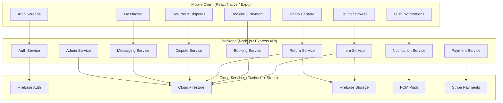
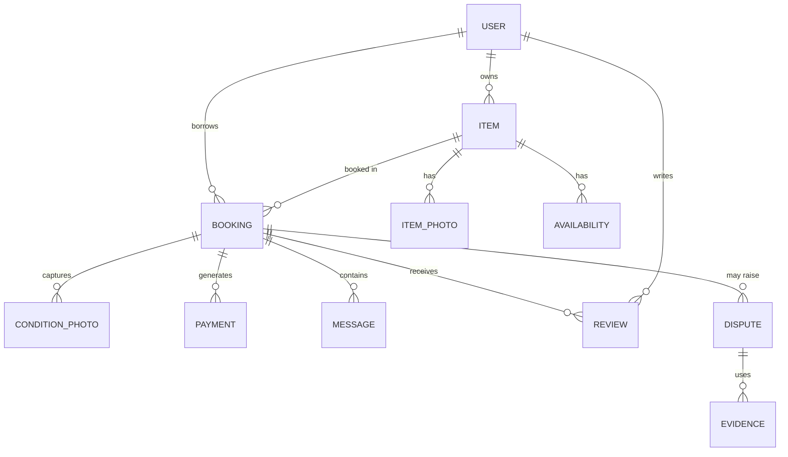
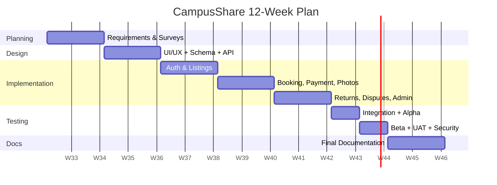

# Campus Student Rental App — Detailed Project Plan

> **Project name:** CampusShare (working title, formerly "CampusRent")
> **Type:** Campus-only, peer-to-peer short-term rental mobile app for students
> **Document version:** 1.0
> **Status:** Planning

---

## Table of Contents

1. [Executive Summary](#1-executive-summary)
2. [Problem Statement & Motivation](#2-problem-statement--motivation)
3. [Goals & Objectives](#3-goals--objectives)
4. [Project Scope](#4-project-scope)
5. [Target Users & Personas](#5-target-users--personas)
6. [Requirements](#6-requirements)
7. [System Architecture](#7-system-architecture)
8. [Tech Stack](#8-tech-stack)
9. [Database Design](#9-database-design)
10. [API Design](#10-api-design)
11. [Module Deep-Dives](#11-module-deep-dives)
12. [UI / UX Design Map](#12-ui--ux-design-map)
13. [Trust & Safety Model](#13-trust--safety-model)
14. [Payment & Deposit Flow](#14-payment--deposit-flow)
15. [Data Sources & Collection Plan](#15-data-sources--collection-plan)
16. [Security & Privacy](#16-security--privacy)
17. [Testing Strategy](#17-testing-strategy)
18. [Project Timeline (12 Weeks)](#18-project-timeline-12-weeks)
19. [Risk Management](#19-risk-management)
20. [Budget & Cost Estimate](#20-budget--cost-estimate)
21. [Future Work](#21-future-work)
22. [Conclusion](#22-conclusion)
23. [References](#23-references)

---

## 1. Executive Summary

CampusShare is a mobile application that enables students within a single university campus to lend and rent short-term items such as lab coats, blazers, sunglasses, calculators, and dumbbells. The app is restricted to verified campus members and builds trust through four pillars:

1. **Campus-only access** — every user is verified against institutional records.
2. **Monetary accountability** — payments and refundable deposits held in escrow.
3. **Photographic evidence** — condition photos captured before and after every rental.
4. **Structured dispute handling** — a clear, auditable resolution process.

The system reduces student spending on items used only occasionally and promotes a safer, more accountable sharing economy than a normal student marketplace. It is developed as a **React Native (Expo)** mobile application backed by a **Node.js/Express REST API** and **Firebase** cloud services for authentication, data storage, file (photo) storage, and push notifications. Payments and deposits are processed via **Stripe**.

This document details the complete plan: problem background, objectives, scope, personas, requirements, architecture, database, API, modules, UI, trust model, payment flows, data sources, security, testing, timeline, risks, and budget.

---

## 2. Problem Statement & Motivation

### 2.1 The Problem

University students frequently purchase items they use rarely or for a short period:

| Item | Typical use case | Purchase cost | Frequency of use |
|------|------------------|---------------|------------------|
| Lab coat | A handful of lab sessions per term | ₹20–40 | Rare |
| Blazer | One interview / event | ₹40–120 | Rare |
| Sunglasses | A single outdoor event | ₹10–40 | Rare |
| Calculator (TI-84) | One exam period | ₹80–120 | Seasonal |
| Dumbbells | A 2-week fitness challenge | ₹20–60 | Short burst |

Buying new items for occasional use wastes money, storage, and materials. Borrowing informally from friends is common but has no accountability: no evidence of item condition at hand-off, no agreed rental terms, and no recourse if an item is returned damaged or lost.

### 2.2 Why a Campus-Only Model?

- **Identity trust:** every member is a registered student/staff of the same institution, drastically reducing the fraud and theft risk of open marketplaces.
- **Proximity:** all items are on campus, enabling easy pickup/return and quick dispute resolution.
- **Community accountability:** users are tied to a real institutional identity, so reputation matters.

### 2.3 Why This Differs From Generic Marketplaces

Generic rental/marketplace apps (e.g., general classifieds) lack:
- Institutional identity verification
- Before/after photographic condition proof
- Refundable deposit escrow
- A campus-embedded dispute process

CampusShare combines all four, making it more **secure and evidence-based** than a normal student marketplace.

---

## 3. Goals & Objectives

### 3.1 Project Goals

- **G1:** Reduce student spending by enabling affordable short-term rentals of campus items.
- **G2:** Make peer-to-peer borrowing safe through verification, deposits, and photo evidence.
- **G3:** Build a usable, trustworthy mobile experience students actually adopt.
- **G4:** Establish an auditable lifecycle from listing → booking → rental → return → refund.

### 3.2 SMART Objectives

| # | Objective | Metric / Target |
|---|-----------|-----------------|
| O1 | Verify every account | 100% of registered users verified via campus email/ID before transacting |
| O2 | Photo evidence on every rental | ≥ 99% of completed rentals have before + after photos |
| O3 | Deposit protection | 100% of deposits returned or disputed within 48h of return confirmation |
| O4 | Onboarding | New user completes verification in ≤ 5 minutes |
| O5 | Listing creation | Listing published in ≤ 3 minutes from first photo |
| O6 | Booking UX | Booking + payment completed in ≤ 5 minutes |
| O7 | Adoption | ≥ 300 active users and ≥ 500 listings in first 12 weeks of pilot |
| O8 | App quality | ≥ 90% success on automated tests; 0 critical bugs at release |
| O9 | Satisfaction | UAT mean satisfaction score ≥ 4.0 / 5.0 |

---

## 4. Project Scope

### 4.1 In Scope (v1.0)

- Campus user registration & verification (institutional email / student ID).
- Item listing with photos, category, price/day, deposit, availability calendar.
- Condition photo capture (before/after) with watermarking + timestamping.
- Search, category filter, and item detail view.
- Booking with date range, availability check, and price calculation.
- Payments via Stripe (rental fee) and deposit collection (held in escrow).
- Return confirmation workflow.
- Dispute handling (raise, evidence submission, resolution).
- Push notifications (booking, payment, return, dispute status).
- In-app messaging between lender and borrower.
- Admin dashboard (verification queue, dispute queue, analytics).
- User profiles with ratings and review history.

### 4.2 Out of Scope (v1.0)

- Multiple-campus / cross-institution support (single campus pilot first).
- Item delivery / shipping (in-person pickup only).
- Insurance integration.
- Long-term rental contracts.
- In-app escrow wallet balance (deposits returned directly to source card).
- Offline-first advanced sync.

### 4.3 Assumptions & Constraints

- Pilot runs on a single campus with an active student population.
- Users have smartphones (iOS or Android) and a credit/debit card.
- Campus IT will provide a verified email domain or ID lookup endpoint for verification.
- Stripe and Firebase available in the deployment region.
- 12-week academic timeline; team of ~3–4 developers.

---

## 5. Target Users & Personas

### 5.1 Borrower — "Riya, the Budget-Conscious Second Year"

- **Age:** 19–22 | **Tech level:** high (daily smartphone use)
- **Scenario:** Needs a lab coat for one lab week and a blazer for a campus interview; can't justify buying both.
- **Needs:** quick search, clear pricing, cheap daily rates, trust that the item matches photos, and that a dispute would be handled fairly.
- **Pain points:** scared of hidden damage charges; dislikes apps with slow verification.

### 5.2 Lender — "Marcus, the Occasional Monetizer"

- **Age:** 21–24 | **Tech level:** medium
- **Scenario:** Owns a graphing calculator used once a year; wants to earn from it and ensure it returns in the same condition.
- **Needs:** easy listing, photo evidence, deposit protection, predictable payout, confidence in borrower identity.
- **Pain points:** worried about theft or damage; no time for complex listing processes.

### 5.3 Campus Administrator — "Dr. Chen, Student Affairs"

- **Age:** 35–55 | **Tech level:** low–medium
- **Scenario:** Responsible for student wellbeing and campus conduct; wants a safe, fair, auditable service.
- **Needs:** admin approval of verification, visibility into disputes, basic analytics, and escalation path.
- **Pain points:** limited time; needs a simple queue, not a data-heavy dashboard.

---

## 6. Requirements

### 6.1 Functional Requirements (FR)

| ID | Requirement |
|----|-------------|
| FR-01 | User can register with campus email and student ID number. |
| FR-02 | System verifies user against campus records before any transaction. |
| FR-03 | Verified user can create an item listing (title, category, description, photos, price/day, deposit, availability). |
| FR-04 | Listing requires at least one "condition" photo before publishing. |
| FR-05 | Users can search items by keyword and filter by category. |
| FR-06 | User can view item details, lender rating, and availability calendar. |
| FR-07 | User can request a booking for a date range; system validates availability. |
| FR-08 | Lender can accept or decline a booking request. |
| FR-09 | System calculates total = (price/day × days) + deposit. |
| FR-10 | Borrower pays rental fee + deposit via Stripe at booking acceptance. |
| FR-11 | System holds deposit in escrow until return confirmation. |
| FR-12 | At pickup, borrower captures "before" condition photos; system stores them timestamped. |
| FR-13 | At return, borrower captures "after" condition photos; lender confirms return. |
| FR-14 | On confirmed return, system releases rental earnings to lender and refunds deposit to borrower's card. |
| FR-15 | Either party can raise a dispute within 48h of return; system freezes affected funds. |
| FR-16 | Admin can review dispute evidence (photos, messages) and rule in favor of lender or borrower. |
| FR-17 | System sends push notifications for booking, payment, return, and dispute events. |
| FR-18 | Lender and borrower can exchange in-app messages for a booking. |
| FR-19 | Users can rate and review each other after a completed rental. |
| FR-20 | Admin dashboard lists pending verifications and pending disputes. |
| FR-21 | Users can cancel a booking before pickup per the cancellation policy. |

### 6.2 Non-Functional Requirements (NFR)

| ID | Requirement | Target |
|----|-------------|--------|
| NFR-01 | Availability | 99.5% uptime for core API |
| NFR-02 | Performance (API) | p95 < 300ms for reads, < 800ms for writes |
| NFR-03 | Performance (mobile) | Cold start < 3s; screen nav < 300ms |
| NFR-04 | Scalability | Support 10k registered users, 5k concurrent |
| NFR-05 | Security | OAuth/Firebase Auth, encryption in transit (TLS) and at rest |
| NFR-06 | Privacy | GDPR-style: data minimization, right to delete, 12-month retention for records |
| NFR-07 | Usability | ≥ 4.0/5 SUS score in UAT |
| NFR-08 | Reliability | No data loss; photo uploads retried automatically |
| NFR-09 | Auditability | Every financial and dispute action logged |
| NFR-10 | Compatibility | iOS 16+ and Android 10+ |

### 6.3 Constraints

- Single campus, verified email domain.
- 12-week academic timeline.
- Student budget; prefer free tiers + minimal paid cloud usage.
- Compliance with university policy on student transactions.

---

## 7. System Architecture

### 7.1 High-Level Component Diagram



### 7.2 Cloud Service Breakdown

| Service | Provider | Purpose |
|---------|----------|---------|
| Firebase Authentication | Firebase | Email/password + institution email verification, JWT issuance |
| Cloud Firestore | Firebase | NoSQL database for users, items, bookings, transactions, disputes, messages |
| Firebase Storage | Firebase | Condition photos, listing photos, dispute evidence |
| Firebase Cloud Messaging (FCM) | Firebase | Push notifications to Android & iOS |
| Stripe Payments | Stripe | Card payments, deposit capture, refunds, lender payouts |
| Node.js API (hosted on Fly.io/Railway) | Self/VPS | Business logic, orchestration, admin endpoints |

### 7.3 Data Flow — Booking Lifecycle (Overview)

```
Browse → Book → Pay (fee + deposit) → Pickup + "before" photos
      → Rental period → Return + "after" photos → Lender confirms
      → Release earnings + refund deposit → Rate & review
                    ↓ (on conflict)
            Dispute raised → Admin reviews → Funds released per ruling
```

---

## 8. Tech Stack

### 8.1 Mobile Client

| Layer | Choice | Rationale |
|-------|--------|-----------|
| Framework | React Native via **Expo** | Fast dev, OTA updates, cross-platform |
| Language | TypeScript | Type safety across client and API contracts |
| Navigation | React Navigation (bottom tabs + stack) | Matches prototype bottom nav |
| State | TanStack Query + Zustand | Server state caching + lightweight local state |
| UI | Tailwind (NativeWind) | Mirrors `Campusshare.html` styling (Tailwind) |
| Icons | Feather / Lucide icons | Matches prototype icon set |
| Camera | Expo Camera / expo-image-picker | Condition photo capture |
| Payments | Stripe React Native SDK | Card tokenization client-side |
| Notifications | Expo Notifications | Wraps FCM |
| Date handling | date-fns | Booking calendars |

### 8.2 Backend

| Layer | Choice | Rationale |
|-------|--------|-----------|
| Runtime | Node.js (v20+) | Team familiarity (existing Node projects) |
| Framework | Express 5 | Lightweight, widely known |
| Language | TypeScript | Shared types with client |
| Validation | Zod | Runtime request validation |
| Auth | Firebase Admin SDK | Verify JWTs, manage users |
| DB access | Firestore Admin SDK | Direct NoSQL access from server |
| Payments | Stripe Node SDK | PaymentIntents + Transfers |
| Background jobs | Node cron / lightweight queue | Deposit expiry checks, reminders |
| Hosting | Fly.io or Railway | Simple deployment, containerized |

### 8.3 Data & Cloud

| Service | Choice | Notes |
|---------|--------|-------|
| Database | Cloud Firestore | NoSQL; document collections per entity |
| File storage | Firebase Storage | Condition photos + evidence, size-limited |
| Auth | Firebase Auth | Campus email verification hook |
| Push | FCM via Expo Notifications | Topic + device-token targeting |
| Payments | Stripe | Escrow via separate destinations |

### 8.4 Tooling

- **Repo:** Git + GitHub; branch-per-feature.
- **CI:** GitHub Actions — lint, typecheck, unit tests, build.
- **Testing:** Jest (unit), Supertest (API integration), Detox (mobile E2E, later).
- **Analytics:** Firebase Analytics (anonymized).

---

## 9. Database Design

### 9.1 Entity Relationship Overview



### 9.2 Collections (Firestore Documents)

#### users
| Field | Type | Notes |
|-------|------|-------|
| id | string | Firebase UID |
| name | string | Full name |
| campusEmail | string | Verified institutional email |
| studentId | string | Obfuscated/hashed ID |
| verificationStatus | enum | `pending`, `verified`, `rejected` |
| role | enum | `student`, `admin` |
| rating | float | Aggregated |
| reviewCount | int | |
| stripeCustomerId | string | Stripe customer ref |
| createdAt / updatedAt | timestamp | |

#### items
| Field | Type | Notes |
|-------|------|-------|
| id | string | |
| ownerId | ref → users | |
| title | string | |
| category | enum | `academic`, `clothing`, `electronics`, `fitness`, `other` |
| description | string | |
| pricePerDay | number | INR |
| deposit | number | INR |
| status | enum | `draft`, `published`, `booked`, `inactive` |
| photos | array<ref> | item photos |
| location | string | campus zone (e.g., North Campus) |

#### item_photos
| Field | Type | Notes |
|-------|------|-------|
| id | string | |
| itemId | ref → items | |
| url | string | Firebase Storage path |
| kind | enum | `primary`, `gallery`, `condition` |

#### availability
| Field | Type | Notes |
|-------|------|-------|
| id | string | |
| itemId | ref → items | |
| date | date | Single date per doc (day-level granularity) |
| state | enum | `open`, `booked`, `blocked` |

#### bookings
| Field | Type | Notes |
|-------|------|-------|
| id | string | |
| itemId | ref → items | |
| lenderId | ref → users | item owner |
| borrowerId | ref → users | |
| startDate / endDate | date | inclusive days |
| totalRental | number | pricePerDay × days |
| deposit | number | |
| status | enum | `requested`, `accepted`, `paid`, `active`, `returned`, `disputed`, `cancelled` |
| pickupConfirmedAt | timestamp | when before-photos done |
| returnConfirmedAt | timestamp | when lender confirmed return |

#### condition_photos
| Field | Type | Notes |
|-------|------|-------|
| id | string | |
| bookingId | ref → bookings | |
| capturedBy | ref → users | |
| stage | enum | `before`, `after` |
| url | string | |
| capturedAt | timestamp | server time |

#### payments
| Field | Type | Notes |
|-------|------|-------|
| id | string | |
| bookingId | ref → bookings | |
| type | enum | `rental_fee`, `deposit_capture`, `deposit_refund`, `lender_payout` |
| amount | number | INR |
| stripeIntentId | string | PaymentIntent / Transfer id |
| status | enum | `pending`, `succeeded`, `failed`, `refunded`, `frozen` |
| createdAt | timestamp | |

#### disputes
| Field | Type | Notes |
|-------|------|------|
| id | string | |
| bookingId | ref → bookings | |
| raisedBy | ref → users | |
| reason | enum | `damage`, `missing_item`, `late_return`, `other` |
| description | string | |
| status | enum | `open`, `under_review`, `resolved_lender`, `resolved_borrower`, `rejected` |
| adminNote | string | Ruling rationale |
| resolutionAmount | number | Amount deducted, if any |
| resolvedAt | timestamp | |

#### evidence
| Field | Type | Notes |
|-------|------|------|
| id | string | |
| disputeId | ref → disputes | |
| kind | enum | `photo`, `message` |
| ref | string | Storage path or message id |
| submittedBy | ref → users | |

#### messages
| Field | Type | Notes |
|-------|------|------|
| id | string | |
| bookingId | ref → bookings | |
| senderId | ref → users | |
| body | string | |
| createdAt | timestamp | |

#### reviews
| Field | Type | Notes |
|-------|------|------|
| id | string | |
| bookingId | ref → bookings | |
| fromUserId / toUserId | ref → users | |
| rating | number | 1–5 |
| comment | string | |

#### notifications
| Field | Type | Notes |
|-------|------|------|
| id | string | |
| userId | ref → users | |
| type | enum | booking/payment/return/dispute/reminder |
| title / body | string | |
| read | boolean | |
| createdAt | timestamp | |

### 9.3 Indexing Needs

- `items`: `status`, `category`, `location`
- `bookings`: `(itemId, status)`, `(borrowerId, status)`, `(lenderId, status)`
- `availability`: `(itemId, date)`
- `payments`: `(bookingId, type)`

---

## 10. API Design

Base URL: `https://api.campusshare.app/v1` (all endpoints require `Authorization: Bearer <JWT>` except `auth` endpoints).

### 10.1 Auth
| Method | Path | Description |
|--------|------|-------------|
| POST | `/auth/register` | Register with campus email + ID |
| POST | `/auth/login` | Login, return JWT |
| GET | `/auth/me` | Current user profile |
| POST | `/auth/verify/start` | Begin verification (OTP to campus email) |
| POST | `/auth/verify/confirm` | Confirm OTP, mark verified |

### 10.2 Items
| Method | Path | Description |
|--------|------|-------------|
| GET | `/items` | Search/filter list (`?q=&category=&location=&page=`) |
| GET | `/items/:id` | Item detail + availability |
| POST | `/items` | Create listing |
| PATCH | `/items/:id` | Update listing |
| DELETE | `/items/:id` | Deactivate/delete listing |
| GET | `/items/:id/availability` | Availability calendar |

### 10.3 Bookings
| Method | Path | Description |
|--------|------|-------------|
| POST | `/bookings` | Request booking (validate availability) |
| PATCH | `/bookings/:id/accept` | Lender accepts |
| PATCH | `/bookings/:id/decline` | Lender declines |
| POST | `/bookings/:id/pay` | Borrower pays fee + deposit (Stripe) |
| POST | `/bookings/:id/pickup` | Confirm pickup + upload before-photos |
| POST | `/bookings/:id/return` | Upload after-photos + mark for lender confirmation |
| POST | `/bookings/:id/confirm-return` | Lender confirms; releases funds + refunds deposit |
| PATCH | `/bookings/:id/cancel` | Cancel per policy |

### 10.4 Payments
| Method | Path | Description |
|--------|------|-------------|
| POST | `/payments/intent` | Create Stripe PaymentIntent for fee+deposit |
| GET | `/payments/:bookingId` | Payment history for a booking |

### 10.5 Disputes
| Method | Path | Description |
|--------|------|-------------|
| POST | `/disputes` | Raise dispute (within 48h of return) |
| GET | `/disputes/:id` | Dispute detail + evidence |
| POST | `/disputes/:id/evidence` | Attach evidence |
| POST | `/disputes/:id/resolve` | Admin ruling (admin role) |

### 10.6 Messaging
| Method | Path | Description |
|--------|------|-------------|
| GET | `/bookings/:id/messages` | List messages |
| POST | `/bookings/:id/messages` | Send message |

### 10.7 Admin
| Method | Path | Description |
|--------|------|-------------|
| GET | `/admin/verifications` | Pending verification queue |
| POST | `/admin/verifications/:id` | Approve/reject (admin role) |
| GET | `/admin/disputes` | Open disputes queue |
| GET | `/admin/analytics` | Usage, revenue, dispute KPIs |

---

## 11. Module Deep-Dives

> The original write-up names seven modules. Each is decomposed below with sub-features, states, and workflow.

### 11.1 Module 1 — User Verification

**Purpose:** Guarantee every transacting user is a real campus member.

**Sub-features:**
- Register with campus email + student ID number.
- Send one-time passcode (OTP) to campus email (whitelisted domain).
- Optional secondary check: student ID card photo upload for admin review.
- Admin approval queue for flagged registrations.
- Status badge: `verified` shown on profile; unverified users cannot book, list, or message.

**States:** `draft` → `pending` → `verified` | `rejected` (with reason, re-apply allowed).

**Workflow:**
1. User submits campus email + ID.
2. System validates email domain against institutional whitelist.
3. System emails OTP; user enters it.
4. If ID photo required, admin reviews within 24h.
5. On success, user can transact.

**Edge cases:** expired OTP (resend with cooldown 60s), wrong ID number (re-verify via admin), email domain mismatch (auto-reject).

---

### 11.2 Module 2 — Item Listing

**Purpose:** Let verified students publish rentable items with full transparency.

**Sub-features:**
- Multi-step listing wizard (title → category → description → photos → price/deposit → availability).
- Category presets: `academic`, `clothing`, `electronics`, `fitness`, `other`.
- Pricing helpers: suggested day-rates per category; deposit suggestion (≈ replacement value).
- Availability editor: mark dates open/blocked; blocks overlap with active bookings.
- Draft autosave; publish requires ≥ 1 primary photo + condition note.
- Listing moderation flags (e.g., prohibited items) → admin review.

**Item states:** `draft` → `published` → `booked` (has active booking) → `inactive` (owner-paused/sold).

---

### 11.3 Module 3 — Condition Photos

**Purpose:** Provide timestamped, tamper-evident visual proof of item state at handoff and return.

**Sub-features:**
- Guided capture: 3 required angles (front, back, damage-zone) with an in-app frame guide.
- Server-side timestamp + location metadata (campus GPS) embedded.
- Watermark overlay (user ID + timestamp) applied on upload.
- Photos stored immutably in Firebase Storage with locked permissions.
- "Before" photos required to start a rental; "after" photos required to close it.
- Photo mismatch detection alert: both parties asked to confirm the pair visually.

**Capture flow (pickup):** borrower captures → borrower confirms → lender confirms → `pickupConfirmedAt` set.
**Capture flow (return):** borrower captures → lender confirms → rental closes.

---

### 11.4 Module 4 — Search & Booking

**Purpose:** Help borrowers find available items and reserve them.

**Sub-features:**
- Keyword search + category chips + campus-zone filter (mirrors prototype).
- Item cards with photo, price/day, deposit, location (matches `Campusshare.html`).
- Detail page: photos, description, lender rating, availability calendar.
- Booking request with date range; instant validation against `availability`.
- Auto price calculation: `totalRental = pricePerDay × days`, plus deposit shown separately.
- Request/accept/decline flow; borrower notified on decision.
- Double-booking prevention via transactional availability writes.

**Booking states:**
```
requested → accepted → paid → active → returned
                ↘ declined → closed
   any → cancelled (per cancellation policy)
   active/returned → disputed (freezes funds)
```

---

### 11.5 Module 5 — Payment & Deposit Management

**Purpose:** Collect fees, hold deposits in escrow, pay lenders, and refund safely.

**Sub-features:**
- Stripe PaymentIntent covering `rental fee + deposit` at acceptance.
- Deposit held on the platform (authorized but captured separately).
- On confirmed return: rental fee transferred to lender; deposit refunded to borrower's card.
- On dispute: affected funds frozen until admin ruling.
- Full audit trail per payment (intent id, type, amount, status, timestamps).
- Automatic reminders: deposit-return promise within 48h.
- Support: failed-card retry flow, refund reversals.

**Money flow (happy path):**
```
Borrower card ── fee + deposit ──> Platform escrow
Return confirmed ── fee ──> Lender payout (instant or next-day)
Return confirmed ── deposit ──> Borrower card refund
```

**Money flow (dispute, lender wins):**
```
Dispute frozen ── admin ruling ──> deposit partially/fully retained by lender,
                                   remainder refunded to borrower
```

---

### 11.6 Module 6 — Return Confirmation

**Purpose:** Close rentals cleanly and trigger payments/refunds.

**Sub-features:**
- Borrower uploads "after" photos at the return location.
- Lender receives notification to confirm condition against "before" photos.
- Confirmation unlocks: fee → lender, deposit → borrower, ratings enabled.
- Optional rating prompts after close.
- No-show/late return handling: auto-reminders at end of rental period; escalation to dispute if unconfirmed in 24h.

**Return states:** `pending_after_photos` → `pending_lender_confirmation` → `closed` → (branch) `disputed`.

---

### 11.7 Module 7 — Dispute Handling

**Purpose:** Fair, auditable resolution when something goes wrong.

**Sub-features:**
- Raise dispute within 48h of return (reason: damage, missing item, late return, other).
- Automatic fund freeze on the booking.
- Evidence locker: attach photos + message thread references.
- Admin review queue with side-by-side before/after comparison view.
- Rulings: `resolved_lender`, `resolved_borrower`, `rejected` (no evidence), with admin rationale.
- Resolution amount: partial deduction from deposit; remainder refunded.
- Appeal: one round of re-review if new evidence.

**Dispute states:**
```
open → under_review → resolved_lender | resolved_borrower | rejected
        (evidence attached, admin assigned)
```

---

### 11.8 Cross-Cutting: Notifications & Messaging

**Notifications (FCM):**
| Event | Recipient | Trigger |
|-------|-----------|---------|
| Booking requested | Lender | New request |
| Request decision | Borrower | Accept/decline |
| Payment confirmed | Both | Fee captured |
| Pickup pending | Borrower | Reminder before start |
| Return pending | Borrower | End-of-rental reminder |
| Return confirmation | Lender | After-photos uploaded |
| Deposit refunded | Borrower | Refund processed |
| Dispute update | Both | Status change |

**Messaging:** scoped to a booking; sanitized text; logs retained for dispute evidence.

---

## 12. UI / UX Design Map

### 12.1 Screen Inventory

| Screen | Description |
|--------|-------------|
| Onboarding | Value prop + sign up/login CTA |
| Login / Register | Campus email + ID; verification status banner |
| Home (Feed) | Search bar, category chips, item grid — mirrors `Campusshare.html` |
| Search Results | Filtered list |
| Item Detail | Photos, price/day, deposit, lender, availability calendar, Book button |
| Listing Wizard | Multi-step create (photos, pricing, availability) |
| My Listings | Owner's items + status |
| Bookings (Borrowed) | Active/past bookings, action buttons |
| Bookings (Rented) | Lender's accepted requests, return actions |
| Booking Detail | Timeline, photos, messages, pay/cancel/return actions |
| Checkout / Payment | Stripe payment sheet; fee + deposit breakdown |
| Photo Capture | Guided condition photo capture (before/after) |
| Returns | Upload after-photos + confirm return |
| Disputes | Raise dispute, evidence, status |
| Messages | Booking-scoped chat |
| Profile | Verification badge, rating, reviews, settings |
| Admin Dashboard | Verification queue, dispute queue, analytics |

### 12.2 Navigation Flow

```
Onboarding → Login/Register → [verification pending → status screen]
Home ─────────────────────────────────────────────► Item Detail ─► Booking ─► Pay
  │                                                    ▲
  ├─ Category chips (All, Academic, Clothing,          │
  │   Electronics, Fitness) ──► Filtered feed           │
  ├─ Bottom Tabs: Home | Messages | +Create | Returns | Profile
  └─ Search bar ──► Search Results
Profile ◄── Settings ── My Listings / My Bookings / My Reviews
Returns ──► After-photo capture ──► Lender confirm ──► Refund screen
```

### 12.3 Design Consistency with Prototype

The existing `Campusshare.html` uses: white header with brand color (blue), "University Verified Only" shield badge, Tailwind styling, bottom tab nav, category pill chips, and card grid with price/day + deposit. The native app keeps all of these patterns for consistency.

### 12.4 Accessibility

- Minimum 44pt touch targets.
- Contrast ≥ WCAG AA.
- Dynamic type support; screen-reader labels on all icons.
- Photo-capture overlay readable in high/low light.

---

## 13. Trust & Safety Model

### 13.1 Identity & Access

- Institutional email verification + optional ID photo review.
- Unverified users are read-only.
- JWT with role claims; admin endpoints enforce admin role server-side.

### 13.2 Transaction Protection

- Full deposit held in escrow before item changes hands.
- Before/after photo pairs required to open/close every rental.
- Both parties must confirm condition at each handoff.

### 13.3 Accountability

- Persistent reputation: ratings + reviews tied to completed rentals.
- Repeat offense flagging: repeated damage/missing claims → temporary ban.
- Audit log of every financial and dispute action.

### 13.4 Dispute Resolution Policy (v1)

1. Dispute must be raised ≤ 48h after return.
2. Both parties can attach evidence within 72h.
3. Admin reviews within 5 business days.
4. Ruling based on: photo evidence > message records > testimony.
5. Deductions limited to deposit amount (unless escalated).
6. One appeal with new evidence.

---

## 14. Payment & Deposit Flow (Detailed)

### 14.1 PaymentIntent Design

A single Stripe `PaymentIntent` is created at booking acceptance:
- `amount = totalRental + deposit`
- `transfer_data` / separate `Capture` for deposit portion
- Deposit is captured immediately but **held** (not paid out) until return.

### 14.2 Happy Path Timeline

| Step | Action | Money |
|------|--------|-------|
| 1 | Booking accepted | — |
| 2 | Borrower pays | −(fee + deposit) → platform |
| 3 | Pickup + before photos | — |
| 4 | Rental completes | — |
| 5 | Lender confirms return | fee → lender |
| 6 | Deposit released | +deposit → borrower card |
| 7 | Ratings enabled | — |

### 14.3 Dispute Path

| Step | Action |
|------|--------|
| 1 | Dispute raised ≤48h → funds frozen |
| 2 | Evidence window 72h |
| 3 | Admin ruling |
| 4 | Lender wins: retained deposit paid to lender, rest refunded |
| 5 | Borrower wins: full deposit refunded; fee still paid to lender |

### 14.4 Cancellation Policy (v1)

- Borrower cancels ≥ 48h before pickup: full refund.
- Borrower cancels < 48h: fee retained, deposit refunded.
- Lender cancels after booking: no charge to borrower; borrower compensated with credit.

### 14.5 Payouts

- Lender payout via Stripe Connect (instant or standard 2-day).
- Deposit refund via `Refund` on captured charge → returns to original card.

---

## 15. Data Sources & Collection Plan

> The original write-up states data will come from surveys, listings, and testing feedback.

### 15.1 Survey Data

- **Survey 1 — Demand (Week 1):** Which items do students need short-term? (Likert + open text). Sample: 200+ students.
- **Survey 2 — Pricing (Week 3):** Willingness-to-pay per category; deposit tolerance. Sample: 100+.
- **Survey 3 — Trust (Week 4):** What makes students trust/fear peer renting? Inform trust/safety design.

### 15.2 Listing & Usage Data

- Item metadata (category, price/day, deposit) → pricing calibration.
- Booking/availability heatmaps → which items are in demand.
- Search queries → feed synonyms and category improvements.

### 15.3 Testing Feedback

- Alpha: 10 internal testers (dev team + friends) — crash/logic bugs.
- Beta: 30 students — real listings + bookings on test payments.
- UAT: structured script (see §17) measuring SUS, task success, and qualitative feedback.

### 15.4 Privacy of Collection

- All survey/usage data anonymized or pseudonymized.
- Opt-in consent; ability to withdraw.
- Institutional ethics approval requested where required.

---

## 16. Security & Privacy

### 16.1 Authentication & Authorization

- Firebase Auth with passwordless or email+password; strong password policy.
- Server-side role enforcement (Firestore Security Rules + Admin SDK checks).
- Short-lived JWTs; refresh rotation.

### 16.2 Data Protection

- Encryption in transit: TLS 1.2+ everywhere.
- Encryption at rest: Firestore/Storage default encryption; AppCheck for client traffic.
- PII minimization: student ID stored hashed; emails used only for verification.
- Photo watermarking prevents silent evidence tampering.

### 16.3 Firestore Security Rules (key rules)

```text
- users: write own doc; read public limited profile
- items: create if user verified; update/delete only owner or admin
- bookings: read only participants; write via transaction rules
- payments: server-write only; client read own
- disputes: participants + admin
- messages: booking participants
```

### 16.4 Compliance & Retention

- GDPR-style rights: export, delete account (records anonymized after 12 months).
- Financial records retained 24 months (tax/compliance).
- COPPA: users must be ≥ 13; campus context implies adults.
- Incident response: notify admin on security events; log review weekly.

### 16.5 Threat Scenarios & Mitigations

| Threat | Mitigation |
|--------|-----------|
| Fake account | Campus email OTP + optional ID review |
| Chargeback abuse | Photo evidence + deposit escrow |
| Photo tampering | Server timestamp + watermark + immutable storage |
| Double-booking | Transactional availability writes |
| Payment bypass | All payments via Stripe, server-validated intents |
| Stolen item | Verified identity + dispute escrow freeze |
| Message abuse | Reporting + admin review |

---

## 17. Testing Strategy

### 17.1 Test Levels

| Level | Tool | Scope |
|-------|------|-------|
| Unit | Jest | Services, price calc, date logic, validation |
| API integration | Supertest | Endpoint contracts, auth, transactions |
| Security | OWASP ZAP + manual | Injection, auth bypass, rules |
| Mobile E2E | Detox / Maestro | Booking happy path, photo flow |
| UAT | Structured sessions | 20–30 students, SUS + task success |
| Performance | k6 (light) | API p95 latency under load |

### 17.2 Critical Test Cases (sample)

| ID | Scenario | Expected |
|----|----------|----------|
| TC-01 | Unverified user books item | Rejected with 403 + message |
| TC-02 | Double-book same item/date | Second request fails; no overlap |
| TC-03 | Pay with insufficient funds | Payment fails; booking stays `accepted`; retry allowed |
| TC-04 | Return without after-photos | Return blocked until photos uploaded |
| TC-05 | Dispute without evidence | Rejected with rationale |
| TC-06 | Lender confirms return | Fee → lender, deposit → borrower, ratings enabled |
| TC-07 | Cancel < 48h | Fee retained, deposit refunded |
| TC-08 | Photo upload interrupted | Retry; no partial record |
| TC-09 | Admin resolves dispute | Funds distributed per ruling; audit log written |

### 17.3 UAT Plan

- **Participants:** 20–30 verified students (mixed borrower/lender roles).
- **Tasks:** register & verify, list an item, book & pay, capture before/after photos, return, raise a dispute.
- **Metrics:** task success rate, time-on-task, SUS score, Net Promoter Score, open feedback.
- **Exit criteria:** SUS ≥ 70; all critical tasks ≥ 90% success; no critical bugs open.

---

## 18. Project Timeline (12 Weeks)

> Matches the weeks 1–12 plan from the original write-up.

| Week | Phase | Key Deliverables |
|------|-------|------------------|
| 1 | Planning & Requirements | Surveys, user interviews, PRD, persona validation |
| 2 | Planning & Requirements | Requirements spec, scope freeze, risk register v1 |
| 3 | Design | Wireframes, UI mockups (from prototype), survey on pricing |
| 4 | Design | Database schema, API contract, trust/safety design, prototype walkthrough |
| 5 | Implementation | Project scaffold, Firebase setup, auth + verification module |
| 6 | Implementation | Listing, search, availability, booking module |
| 7 | Implementation | Payments + deposit escrow, condition-photo capture |
| 8 | Implementation | Returns, disputes, messaging, notifications, admin dashboard |
| 9 | Testing | Unit + API integration, alpha fixes |
| 10 | Testing | Beta with 30 students, UAT, security pass |
| 11 | Documentation & Submission | Final UAT report, user guide, presentation |
| 12 | Documentation & Submission | Final docs, submission, demo |

### Gantt-style Summary



---

## 19. Risk Management

| # | Risk | Likelihood | Impact | Mitigation |
|----|------|-----------|--------|-----------|
| R1 | Theft / item loss | Med | High | Deposit escrow, verified identity, dispute process |
| R2 | Damage disputes | High | Med | Before/after photos, evidence rules |
| R3 | Low adoption | Med | High | Surveys, cheap pricing, launch incentive, campus partnerships |
| R4 | Stripe/Firebase regional limits | Low | Med | Verify availability early; alternative processors |
| R5 | Campus IT won't verify emails | Med | High | Fallback: ID-card photo + admin manual review |
| R6 | Scope creep | Med | Med | Feature freeze at Week 4; MVP-first |
| R7 | Payment disputes/chargebacks | Med | High | Photo evidence trail, escrow, clean terms |
| R8 | Team capacity (3–4 devs, 12 wks) | High | Med | Prioritized backlog, weekly demos, cut non-core features |
| R9 | Data privacy violations | Low | High | Compliance review, data minimization, retention policy |
| R10 | App store approval delays | Low | Med | Start review submission early (Week 9) |

---

## 20. Budget & Cost Estimate

### 20.1 Cloud & Third-Party (per month, estimated)

| Item | Service | Est. Cost |
|------|---------|-----------|
| Auth (10k users) | Firebase Auth | ₹0 (free tier) |
| Firestore | Firebase | ₹0–₹10 |
| Storage | Firebase Storage | ₹0–₹5 |
| Push | FCM | ₹0 |
| Payments | Stripe | 2.9% + ₹0.30 per txn + Connect fees |
| Hosting | Fly.io/Railway | ₹5–₹25 |
| **Total platform** | | **₹10–₹40/month** |

### 20.2 One-Time / Development

| Item | Cost |
|------|------|
| Domain (api.campusshare.app) | ~₹12/yr |
| Apple Developer Program (required for iOS) | ~₹99/yr |
| App Store / Play publishing | Play ₹25 (one-time) |
| Marketing (campus flyers, incentives) | ~₹100 |
| **Total one-time** | **~₹236 + tax** |

### 20.3 Revenue Model (optional, not for MVP)

- 5–10% commission on rental fee per booking.
- No fee on deposit portion.

---

## 21. Future Work

- **Cross-campus expansion:** support multiple verified institutions with per-campus rules.
- **In-app wallet:** hold balances for faster refunds and credits.
- **Insurance integration:** damage coverage tier for high-value items.
- **Smart lockers / kiosks:** contactless pickup-return hubs with QR handoff.
- **AI photo comparison:** automated before/after damage detection to speed dispute reviews.
- **Verified events marketplace:** rental bundles for events (graduation, conferences).
- **Advanced availability:** recurring/recurring schedules, waitlists, auto-accept favorites.
- **Offline mode:** queue actions offline and sync.
- **Accessibility & localization:** multi-language support.

---

## 22. Conclusion

CampusShare directly addresses the core weaknesses identified in the literature: the Linköping thesis showed design influences perceived trust but stopped short of real rental control; UniLend demonstrated a structured student rental platform but remained at prototype stage; and the UAT study confirmed student acceptance while flagging optimization and dispute/theft-handling gaps.

By combining **campus-only verification, refundable deposit escrow, timestamped before/after photo evidence, and a structured dispute process**, this project moves beyond a typical student marketplace toward an **evidence-based, accountable, and secure** campus rental system. Over 12 weeks the team will deliver a tested mobile MVP with a clear architecture, secure payments, and a measurable UAT outcome — providing a sustainable, cost-saving borrowing alternative for students.

---

## 23. References

1. Andersson, Viktor, and Isac Pålsson. *Development of a Rental Platform for University Students with Focus on Design to be Perceived as Trustworthy.* Linköping University, 2022.
2. Alferez, Francis Jose B., et al. *Design and Development of a Smart Student Rental Platform for Sustainable Campus Communities.* International Journal of Research and Innovation in Social Science, 2025.
3. Alferez, Francis Jose B., et al. *User Acceptance Testing and Evaluation of a Smart Student Rental Platform for Sustainable Campus Communities.* 2025.
